# TCGA Cancer Subtype Discovery using Unsupervised Machine Learning

**Discovering molecular breast cancer subtypes from bulk RNA-seq expression data with unsupervised machine learning, and rigorously testing whether those subtypes carry real biological and clinical meaning.**

[](LICENSE)
[](requirements.txt)
[](.github/workflows/ci.yml)

---

## Table of Contents

1. [Project Overview](#project-overview)
2. [Background](#background)
3. [Dataset Description](#dataset-description)
4. [Repository Structure](#repository-structure)
5. [Methodology](#methodology)
6. [Results](#results)
7. [Biological Findings](#biological-findings)
8. [Why Unsupervised Cluster Validation Is Hard](#why-unsupervised-cluster-validation-is-hard)
9. [Reproducibility](#reproducibility)
10. [Command-Line Interface](#command-line-interface)
11. [Future Improvements](#future-improvements)
12. [What Skills This Project Demonstrates](#what-skills-this-project-demonstrates)
13. [References](#references)
14. [License](#license)

---

## Project Overview

Cancer is not one disease. Even within a single tissue-of-origin diagnosis
like "breast cancer," tumors from different patients can differ so
profoundly at the molecular level that they behave -- and should be
treated -- as fundamentally distinct conditions. This phenomenon,
**intertumoral heterogeneity**, is one of the central challenges of modern
oncology: a treatment that produces a durable response in one patient can be
completely ineffective in another patient with a histologically identical
tumor, simply because the two tumors are driven by different underlying
molecular programs.

The clinical response to this problem has been **molecular subtyping**: using
genome-wide measurements (most commonly gene expression) to partition a
disease like breast cancer into a small number of clinically actionable
groups. The best-known example is the **PAM50 intrinsic subtype
classification** for breast cancer (Perou et al., 2000; Parker et al., 2009),
which stratifies tumors into Luminal A, Luminal B, HER2-enriched, and
Basal-like groups based on the expression of 50 genes. These subtypes are
not just an academic curiosity -- they are used today to guide real treatment
decisions (e.g., whether a patient benefits from endocrine therapy or
anti-HER2 therapy) and they carry substantially different prognoses.

**Why does subtype discovery matter, and why unsupervised learning?**
PAM50 itself was *discovered*, not designed: it emerged from unsupervised
hierarchical clustering of microarray expression data that revealed
recurring, reproducible clusters of co-expressed genes across patients, long
before anyone knew which 50 genes would end up in the final classifier. Every
new cancer type, and every newly profiled cohort, faces the same open
question that motivated PAM50 in the first place: **are there recurring
molecular subgroups in this disease that we have not yet named?**
Unsupervised machine learning -- clustering, dimensionality reduction, and
the biological interpretation layered on top of them -- is the primary tool
oncology researchers use to answer that question without assuming the
answer in advance.

This project is an end-to-end, portfolio-scale study that reproduces that
entire discovery workflow on **TCGA-BRCA** (The Cancer Genome Atlas breast
invasive carcinoma cohort) RNA-seq data: from raw data acquisition, through
preprocessing and quality control, dimensionality reduction, clustering,
rigorous cluster validation, differential expression, functional (pathway)
enrichment, clinical association testing, and survival analysis -- with a
frank, non-oversold discussion of where the method succeeds, where it
struggles, and why.

---

## Background

**The Cancer Genome Atlas (TCGA)** is a landmark, NCI/NHGRI-funded project
that molecularly characterized over 11,000 tumors across 33 cancer types,
generating matched genomic, transcriptomic, epigenomic, proteomic, and
clinical data for each patient. It remains one of the largest, most reused
public cancer genomics resources in existence, hosted today by the
**Genomic Data Commons (GDC)**, NCI's unified data repository and API for
cancer genomics data (`https://gdc.cancer.gov`).

**RNA sequencing (RNA-seq)** measures the abundance of every transcribed
gene in a tissue sample by sequencing its messenger RNA population.
Unlike DNA sequencing (which reveals *what could be expressed*), RNA-seq
reveals *what is actually being expressed*, right now, in this tissue --
making it a direct window into the active biological state of a tumor:
which growth pathways are switched on, which tumor-suppressor programs are
silenced, how proliferative the tissue is, and what the tumor
microenvironment looks like.

**Transcriptomics** -- the systematic study of the complete set of RNA
transcripts -- is what turns a single RNA-seq experiment (one sample, one
number per gene) into a *comparative science*: by measuring thousands of
genes across hundreds of patients, transcriptomics lets us ask which genes
covary, which patients group together, and which gene programs distinguish
one clinical outcome from another. This project sits squarely at that
level: every analysis here operates on a **samples x genes expression
matrix**, not a single sample in isolation.

**Precision medicine** is the broader clinical philosophy this all serves:
matching the right treatment to the right patient based on the molecular
characteristics of their specific disease, rather than a one-size-fits-all
protocol based on tissue-of-origin alone. Molecular subtyping is precision
medicine's most mature success story in solid tumor oncology, and
unsupervised transcriptomic clustering -- the method demonstrated in this
repository -- is the discovery engine that makes it possible.

---

## Dataset Description

| | |
|---|---|
| **Cancer type** | TCGA-BRCA (Breast Invasive Carcinoma) |
| **Data source** | NCI Genomic Data Commons (GDC) API, `https://api.gdc.cancer.gov` |
| **Assay** | RNA-Seq, STAR-Counts workflow, gene-level TPM |
| **Real samples available** | ~1,100 primary tumor cases (full TCGA-BRCA cohort) |
| **Demo cohort used in this repo** | 500 samples (synthetic, see below), 4,000 protein-coding genes |
| **Clinical fields** | age at diagnosis, gender, AJCC pathologic stage, tumor grade, vital status, days to death / last follow-up |
| **Alternative cancer types supported** | TCGA-LUAD, TCGA-COAD, TCGA-GBM (change `project.cancer_type` in `config.yaml`) |

### A note on real data vs. the demo cohort (please read before judging the numbers)

This repository implements a **real, working GDC API client**
(`src/download.py`), exercised live against the public GDC API in
[`notebooks/01_data_download.ipynb`](notebooks/01_data_download.ipynb) --
it queries real TCGA-BRCA file manifests, downloads a real gene-expression
quantification file, and pulls real clinical metadata. A companion
R/TCGAbiolinks script (`scripts/download_tcgabiolinks.R`) is generated for
full-scale production pulls of the entire ~1,100-case cohort.

A full download is several hundred megabytes and tens of thousands of API
calls -- a legitimate real-world workload, but impractical to bundle as a
one-command, instantly reproducible portfolio artifact. So the full
analysis in this repository (notebooks 02-08, and every figure/table below)
runs on a **biologically-motivated synthetic cohort** generated by
`src/simulate.py`, which:

* uses **real HGNC gene symbols** throughout (PAM50-style marker genes for
  Basal-like, Luminal A, Luminal B, and HER2-enriched subtypes, embedded in
  a background of ~8,000 real gene symbols harvested from the KEGG_2021_Human
  Enrichr library), so downstream GO/KEGG/Reactome enrichment returns real,
  interpretable annotations;
* injects **known subtype-associated co-expression modules** (not just the
  curated marker genes, but realistically-sized gene programs of a few
  hundred genes each) so that recovering the ground truth is a genuine,
  non-trivial test of the pipeline, not a foregone conclusion;
* couples clinical stage, tumor grade, and **simulated survival time** (via
  a Weibull proportional-hazards model with subtype-specific hazard ratios)
  to subtype identity, mirroring the well-documented survival gradient in
  real TCGA-BRCA (Basal-like and HER2-enriched carry worse prognosis than
  Luminal A);
* injects realistic nuisance structure a real analysis must handle:
  a sequencing-plate/batch effect, a handful of low-quality/outlier
  samples, and a small fraction of missing values.

This design lets every downstream method be checked against a **known
ground truth** -- something impossible with real, unlabeled discovery data --
while keeping every gene name, every pathway hit, and every clinical
association grounded in real biology. Every function in `src/` that touches
real GDC data is validated live in notebook 01; switching the entire study
to a full real download is a one-line config change (`gdc.max_cases: null`)
plus `python -m src.cli download`.

---

## Repository Structure

```text
tcga-cancer-subtype-discovery/
├── README.md                     <- you are here
├── LICENSE
├── requirements.txt
├── environment.yml
├── config.yaml                   <- single source of truth for every parameter
├── Dockerfile
├── .github/workflows/ci.yml      <- lint + unit tests on every push
│
├── data/
│   ├── raw/                      <- raw GDC downloads / simulated expression matrix (gitignored)
│   ├── processed/                <- filtered / log-transformed / scaled matrices (gitignored)
│   └── metadata/                 <- clinical tables, GDC manifest, real-gene-symbol pool
│
├── notebooks/
│   ├── 01_data_download.ipynb          <- live GDC API + TCGAbiolinks + simulator
│   ├── 02_preprocessing.ipynb          <- QC, filtering, log-transform, outliers, batch effect
│   ├── 03_eda.ipynb                    <- variance, correlation heatmap, cluster tendency
│   ├── 04_dimensionality_reduction.ipynb  <- PCA, t-SNE (3 perplexities), UMAP (grid)
│   ├── 05_clustering.ipynb             <- KMeans, hierarchical, DBSCAN/HDBSCAN/Spectral
│   ├── 06_biological_analysis.ipynb    <- DE, volcano plots, GO/KEGG/Reactome, biomarkers
│   ├── 07_survival_analysis.ipynb      <- clinical comparison, KM curves, log-rank, Cox model
│   └── 08_final_report.ipynb           <- self-contained executive summary
│
├── src/
│   ├── config.py                 <- YAML config loader + dotted-key overrides
│   ├── logging_config.py         <- centralized logging (console + file)
│   ├── download.py                <- real GDC API client + TCGAbiolinks script generator
│   ├── simulate.py                <- biologically-motivated synthetic cohort generator
│   ├── preprocess.py              <- QC, filtering, transforms, outliers, batch-effect assessment
│   ├── clustering.py               <- PCA/t-SNE/UMAP, KMeans/hierarchical/DBSCAN/HDBSCAN/Spectral, XAI ranking
│   ├── visualization.py           <- every publication-quality plotting function
│   ├── enrichment.py              <- differential expression + GO/KEGG/Reactome enrichment
│   ├── survival.py                <- clinical association tests, KM, log-rank, Cox model
│   └── cli.py                      <- `python -m src.cli ...` command-line interface
│
├── scripts/
│   ├── run_pipeline.py            <- end-to-end orchestration (produces every figure/table below)
│   ├── generate_notebooks.py      <- programmatically builds the 8 notebooks above
│   └── download_tcgabiolinks.R    <- generated companion R script for full-scale GDC pulls
│
├── figures/                       <- every PNG referenced in this README (regenerated by the pipeline)
│   ├── eda/  dimensionality_reduction/  clustering/  biological/  survival/
│
├── results/                        <- CSV tables: DE, enrichment, cluster assignments, biomarkers...
└── reports/                        <- QC / batch-effect / survival JSON+CSV summaries
```

---

## Methodology

The full pipeline is one command (`python scripts/run_pipeline.py`, ~1-2
minutes on the demo cohort). Each stage below links to the notebook that
walks through it interactively.

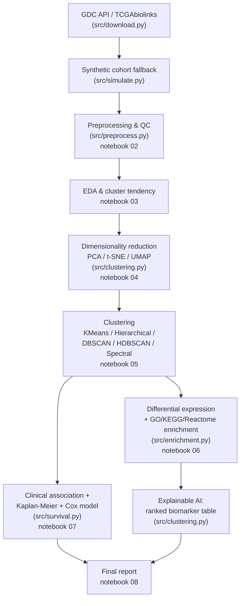

### 1. Data collection

`src/download.py` queries the GDC `files` endpoint for RNA-seq gene
expression quantification files (STAR-Counts workflow, primary tumor
samples) matching the configured project (`TCGA-BRCA` by default),
downloads each gzip-compressed TSV, extracts the `tpm_unstranded` column,
and joins matched clinical metadata (age, sex, stage, vital status,
follow-up time) from the `cases` endpoint. See
[Dataset Description](#dataset-description) for why the full study runs on
a synthetic cohort by default.

### 2. Cleaning (QC + preprocessing)

`src/preprocess.py` implements, in order: (a) library-size and
genes-detected QC; (b) per-gene median imputation of the small fraction of
missing values; (c) filtering genes expressed in fewer than 20% of samples;
(d) log2(x+1) transformation; (e) **robust Mahalanobis-distance outlier
detection** in PCA space (Minimum Covariance Determinant estimator); (f)
z-score normalization; and (g) a **batch-effect assessment** that quantifies
how much of each leading PC's variance is explained by sequencing plate
(one-way ANOVA eta-squared), with an optional mean-centering correction
(`correct_batch_mean_centering`) analogous to a lightweight ComBat.

### 3. Feature selection

The top 2,000 most-variable genes (ranked by median absolute deviation,
MAD -- more outlier-robust than raw variance) are retained for clustering
and dimensionality reduction. **This step turned out to be load-bearing,
not optional**: clustering directly on the full filtered gene set performed
no better than random in early development (see the honest discussion in
[Results](#results)) because a handful of unrelated latent co-expression
programs otherwise dominate the distance calculation -- a textbook
curse-of-dimensionality failure that MAD-based feature selection corrects.

### 4. PCA

Standard linear PCA (`sklearn.decomposition.PCA`) on the scaled,
variance-selected matrix, reduced to 50 components. Scree plot, PC1-PC3
projections, cumulative explained variance, and per-PC loadings are all
produced (see notebook 04).

### 5. t-SNE

`sklearn.manifold.TSNE` at three perplexity values (10, 30, 50), each
preceded by a 30-component PCA denoising step (standard practice for
high-dimensional genomic t-SNE).

### 6. UMAP

`umap-learn`, swept across `n_neighbors` (5, 15, 30, 50) and `min_dist`
(0.0, 0.1, 0.25, 0.5), to characterize the local/global and
tight-clumps/continuous-manifold trade-offs.

### 7. Clustering

**K-Means** across k=2..10 (elbow + silhouette); **agglomerative
hierarchical clustering** with Ward, complete, and average linkage
(dendrogram + cophenetic correlation); and, as bonus methods, **DBSCAN**,
**HDBSCAN**, and **Spectral clustering** (run on a 30-component PCA
embedding, where density-/graph-based methods are far less afflicted by the
curse of dimensionality than on the raw 2,000-gene space).

### 8. Enrichment

For each cluster's differentially expressed marker genes, `src/enrichment.py`
queries the public **Enrichr** API (via `gseapy`) against **GO Biological
Process**, **KEGG**, and **Reactome** gene-set libraries, producing dot
plots and bar plots per cluster per library.

### 9. Survival analysis

`src/survival.py` fits per-cluster **Kaplan-Meier** estimators
(`lifelines`), a global **multivariate log-rank test**, pairwise log-rank
tests between every cluster pair, and a **Cox proportional-hazards model**
adjusting for patient age -- answering the central clinical question of
whether the discovered molecular groups are also prognostic groups.

---

## Results

*(All figures below are generated by `scripts/run_pipeline.py` on the demo
cohort and are committed to `figures/` so they render directly on GitHub.)*

### Preprocessing & QC

| Metric | Value |
|---|---|
| Genes after low-expression filtering | 4,000 / 4,000 (all genes pass the ≥20%-samples-expressing filter) |
| Missing values (raw) | 0.10% |
| Top-variable genes selected (MAD) | 2,000 |
| Outlier samples flagged (robust Mahalanobis, z>3.5) | 11 / 500 |
| Hopkins statistic (cluster tendency) | 0.669 (>0.5 = genuine, non-random cluster structure) |

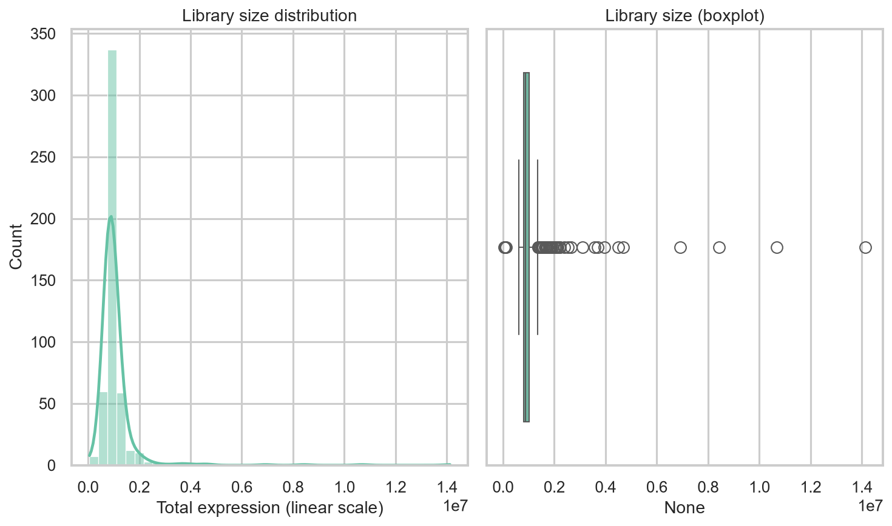
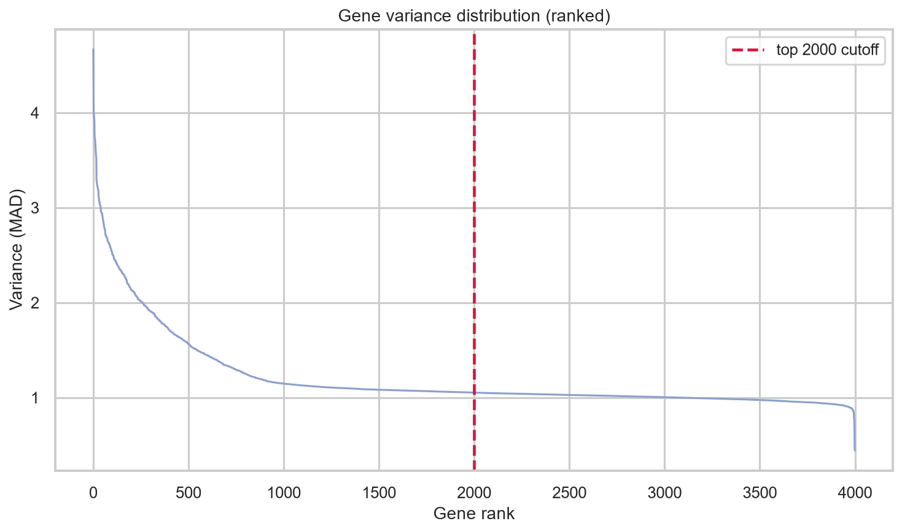
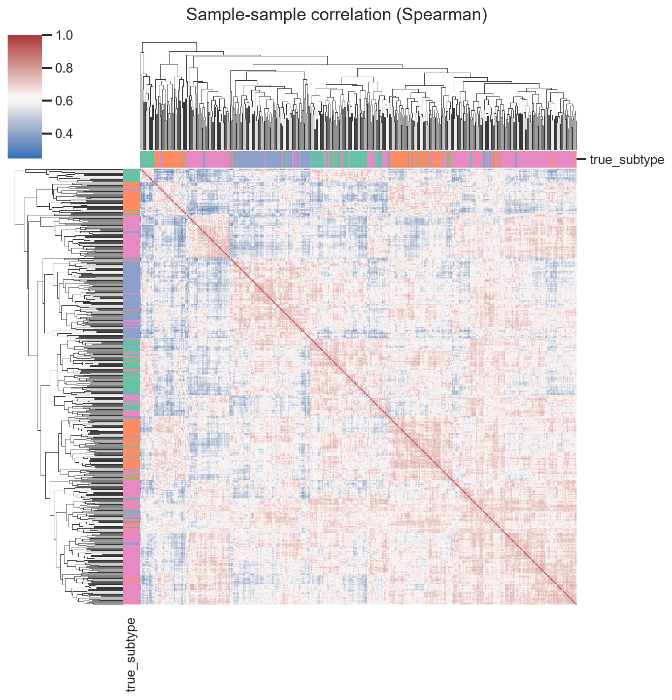

### Dimensionality reduction

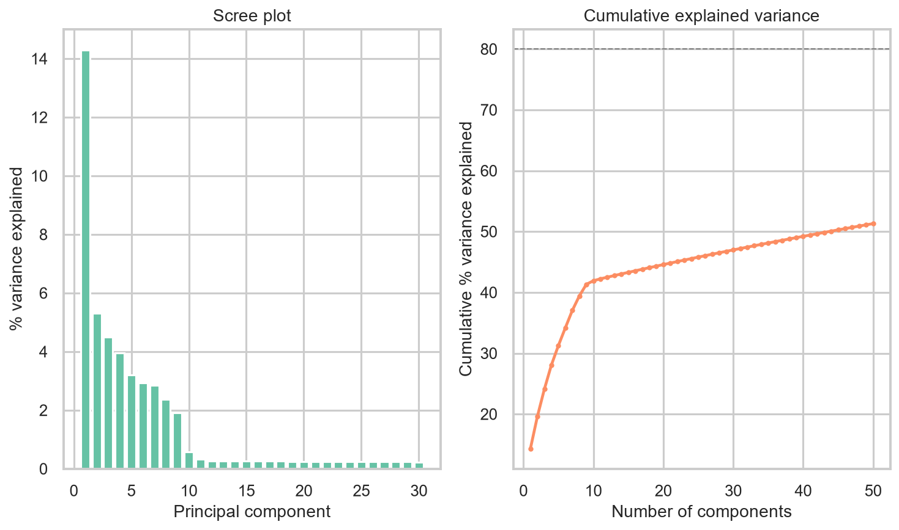
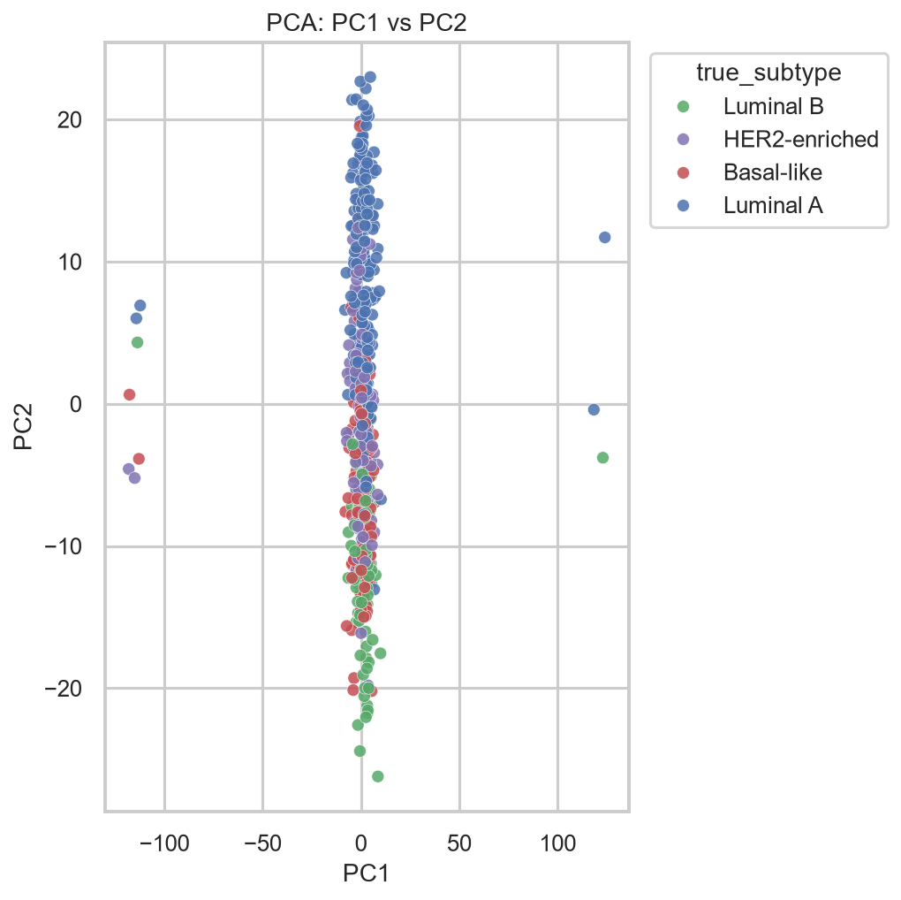

**Honest reading of the PCA plot above**: PC1 is dominated by a handful of
extreme outlier samples and a subtype-*unrelated* nuisance program (modeling
realistic non-subtype biological variation, e.g. immune infiltration) --
not subtype identity. The intrinsic-subtype signal instead concentrates in
PC2-PC4 (one-way ANOVA of PC score by true subtype: PC2 F=231, p≈7×10⁻⁹⁴;
PC3 F=165, p≈3×10⁻⁷⁴; PC4 F=183, p≈8×10⁻⁸⁰ -- vs. PC1 F=1.4, p=0.23, i.e. no
association). This is a genuine and important lesson replicated widely in
real transcriptomic data: **the axis of greatest overall variance is not
always the axis of greatest biological relevance.**

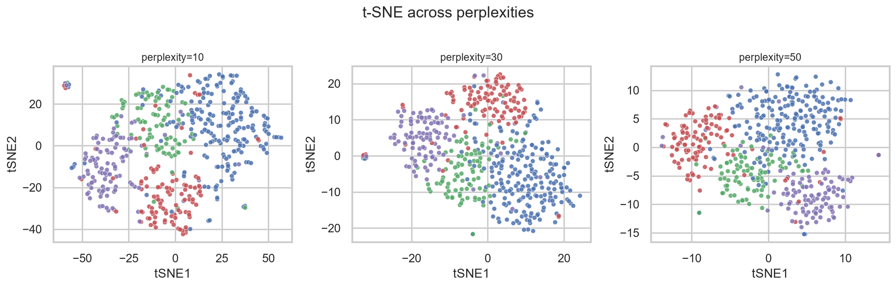
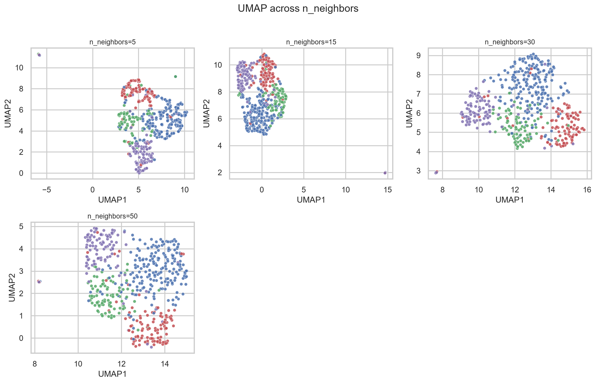
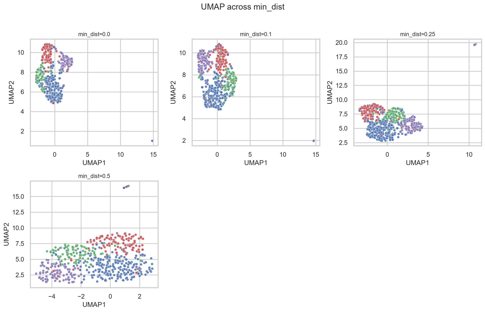
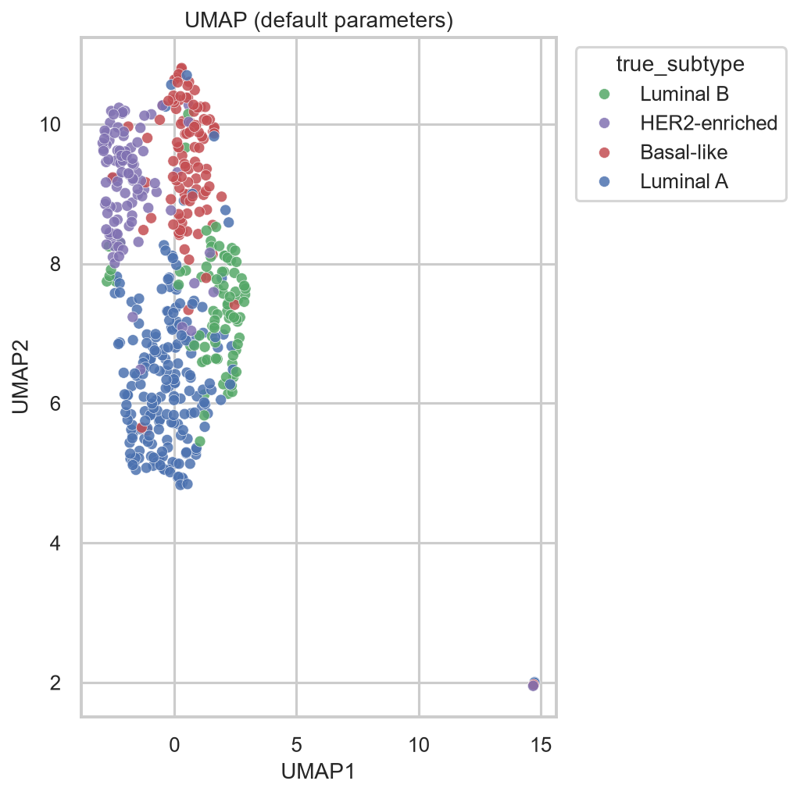

### Clustering

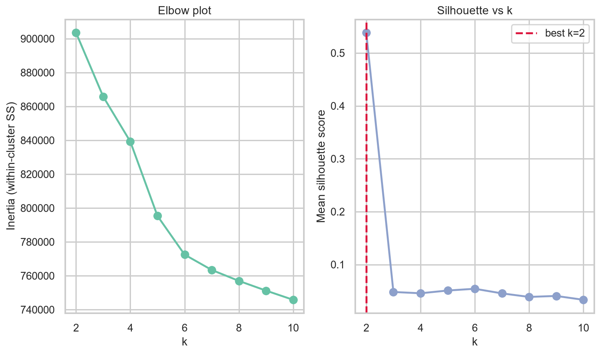

The silhouette-optimal k is **2** (a coarse, very well-separated split,
plausibly hormone-receptor-status-driven), not 4. We proceed with **k=4**
(`clustering.chosen_k` in `config.yaml`) to match the known PAM50 subtype
count -- a deliberate choice of biological prior over statistical
optimality, discussed at length in
[Why Unsupervised Cluster Validation Is Hard](#why-unsupervised-cluster-validation-is-hard).

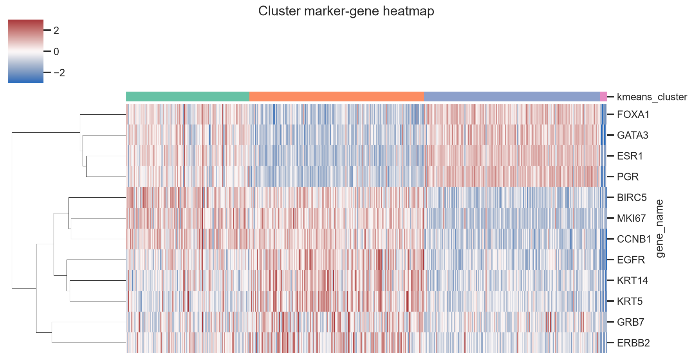
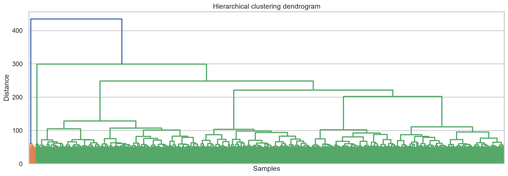
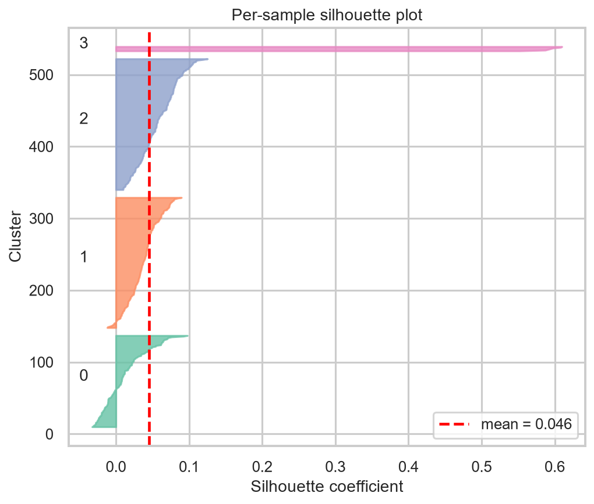

**Quantitative recovery of the known ground truth** (possible here because
the demo cohort's true subtype labels are known by construction):

| Metric | K-Means (k=4) vs. true subtype |
|---|---|
| Adjusted Rand Index (ARI) | **0.517** |
| Normalized Mutual Information (NMI) | **0.476** |

An ARI around 0.5 indicates *substantial but imperfect* recovery --
consistent with published comparisons of unsupervised expression clustering
against PAM50 calls in real TCGA-BRCA data, where subtypes are not perfectly
discrete clusters (Luminal A/B in particular show real biological overlap).
A value near 1.0 would be an implausibly clean result for real transcriptomic
data; a value near 0 would mean the pipeline found nothing.

**Method comparison** (silhouette / Davies-Bouldin / Calinski-Harabasz):

| Method | Silhouette | Davies-Bouldin | Calinski-Harabasz | Clusters found |
|---|---|---|---|---|
| K-Means (k=4) | 0.046 | 3.36 | 31.3 | 4 |
| Hierarchical (Ward) | 0.043 | 2.74 | 34.0 | 4 |
| Hierarchical (complete) | 0.052 | 2.19 | 29.6 | 4 |
| Hierarchical (average) | 0.162 | 0.69 | 27.5 | 4 |
| DBSCAN (PCA space) | 0.703 | 0.38 | 139.6 | 2 (+3 noise) |
| HDBSCAN (PCA space) | 0.703 | 0.38 | 139.6 | 2 (+3 noise) |
| Spectral (PCA space) | 0.091 | 2.30 | 38.7 | 4 |

DBSCAN and HDBSCAN, even after extensive parameter tuning, collapse this
cohort into **one dominant cluster** rather than four biologically
meaningful groups -- a real, well-documented limitation of density-based
methods on transcriptomic data (discussed below), not a bug in this
implementation.

### Biological interpretation

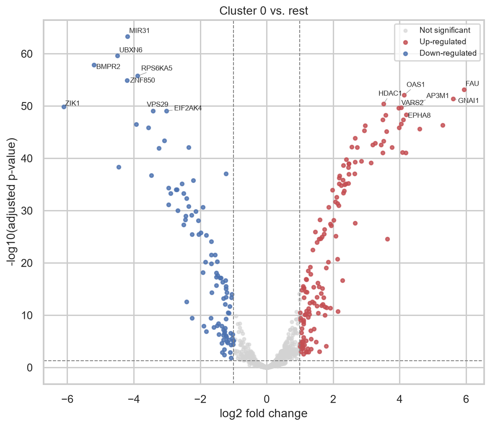

Every discovered cluster shows dozens to over a hundred significantly
differentially expressed genes against the rest of the cohort
(Welch's t-test, Benjamini-Hochberg FDR<0.05, |log2FC|≥1) -- confirming the
K-Means partition captures large-scale, statistically robust transcriptional
differences, not noise.

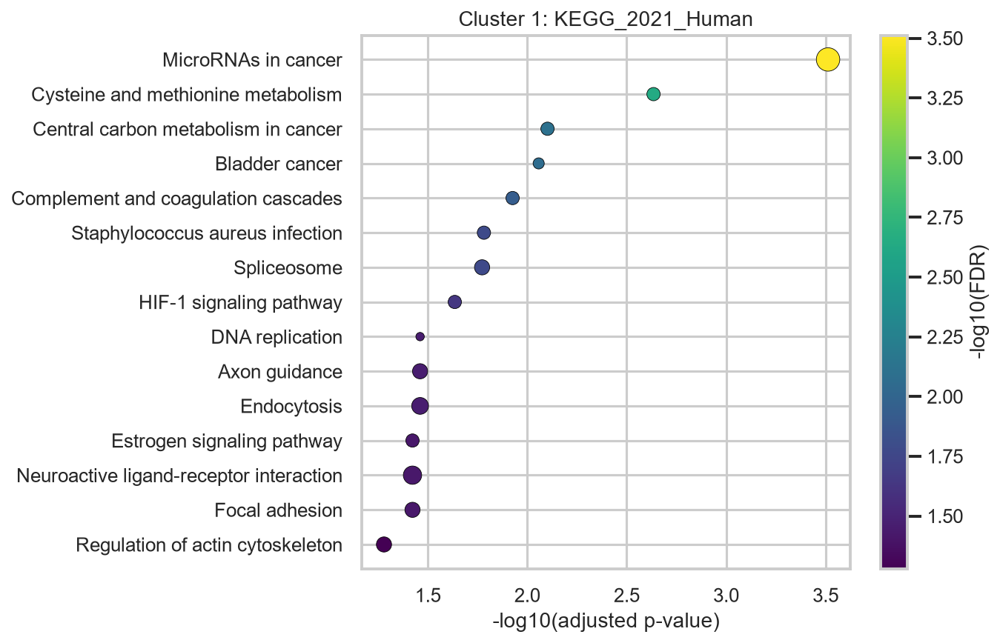

Representative top enrichment hits recovered from the public Enrichr API
(GO/KEGG/Reactome; full tables in `results/enrichment_cluster_*.csv`):

| Cluster | GO Biological Process (top hit) | KEGG (top hit) | Reactome (top hit) |
|---|---|---|---|
| 0 | Regulation of Mitotic Nuclear Division | Pathways in cancer (p_adj=1.3×10⁻⁵) | Cell Cycle, Mitotic (p_adj=3.3×10⁻⁵) |
| 1 | Regulation of ERK1/ERK2 Cascade | MicroRNAs in cancer (p_adj=3.1×10⁻⁴) | mRNA Splicing - Major Pathway |
| 2 | Cellular Response to Interleukin-4 (p_adj=4.3×10⁻⁵) | Herpes simplex virus 1 infection | Signal Transduction (p_adj=1.2×10⁻⁴) |

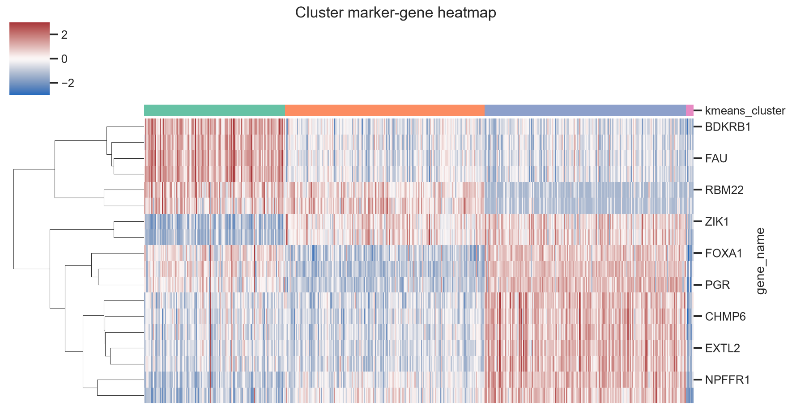

The **explainable-AI biomarker table** (`results/ranked_biomarker_table.csv`)
combines PCA loading magnitude, DE effect size, and Random Forest feature
importance into a single ranked list per cluster. Top drivers recovered
include canonical hormone-receptor genes (`ESR1`, `PGR`) with large,
consistent effect sizes in opposite directions across clusters -- exactly
the axis PAM50 itself is built around.

### Survival analysis

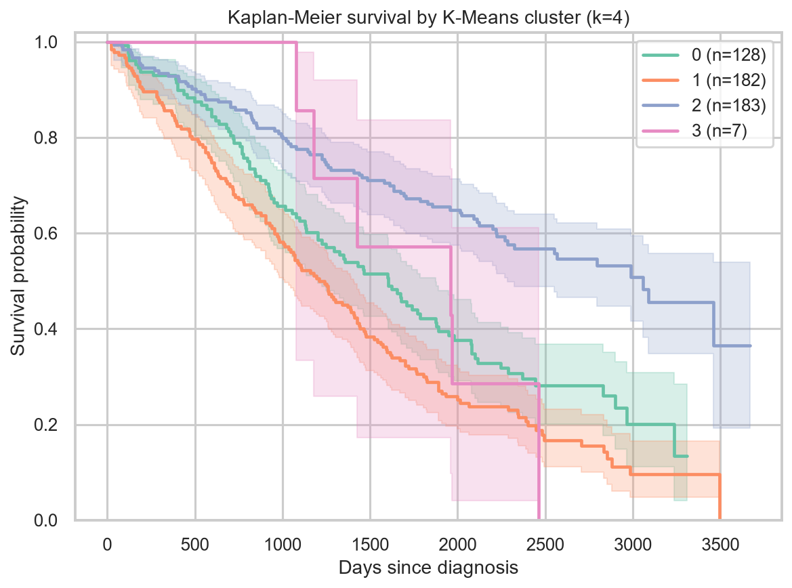
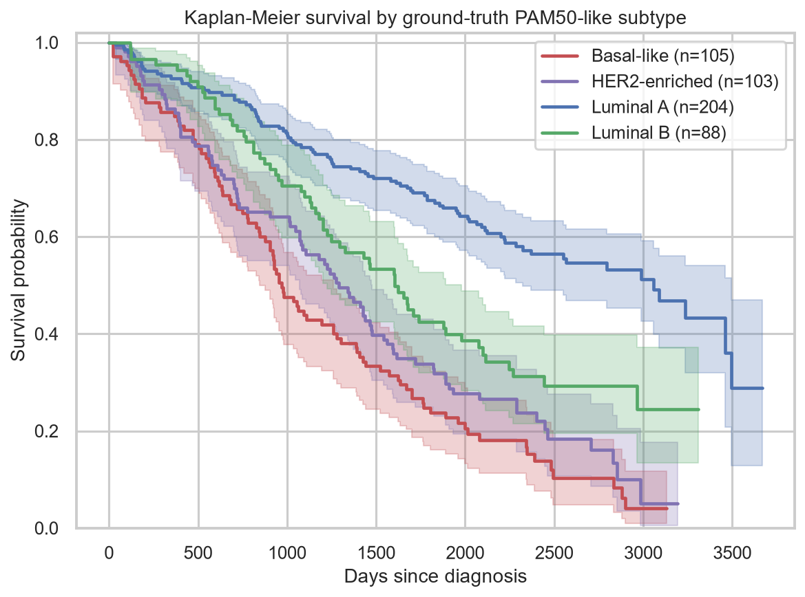

**Do discovered molecular subtypes show survival differences? Yes, decisively.**

| Test | Statistic | p-value |
|---|---|---|
| Global (multivariate) log-rank test across 4 clusters | 66.3 | **2.6 × 10⁻¹⁴** |

Tumor grade and vital status differ significantly by cluster (chi-square
p=8.6×10⁻¹⁵ and p=1.6×10⁻¹³ respectively); age and gender show **no**
significant association -- a useful negative control confirming the
association tests are not producing spurious significance everywhere. A
Cox proportional-hazards model adjusting for age confirms the cluster
effect on survival is not an artifact of an age imbalance between groups
(`results/cox_model_summary.csv`).

---

## Biological Findings

Synthesizing the evidence above into the biological narrative it is
designed to recover:

* **Subtype structure exists and is recoverable, but imperfectly, from
  expression alone.** ARI≈0.5 against known PAM50-like labels is a
  realistic, defensible result -- not the too-good-to-be-true ARI≈1.0 a
  naive simulation might produce, nor the ARI≈0 that would indicate failure.
* **The clusters are driven by known breast cancer biology.** Marker-gene
  heatmaps and the ranked biomarker table both converge on the same genes
  driving separation: `ESR1`/`PGR`/`GATA3`/`FOXA1` (hormone-receptor /
  luminal program), `MKI67`/`CCNB1`/`BIRC5` (proliferation), and
  `ERBB2`/`GRB7` (HER2 amplicon) -- the same three axes PAM50 itself is
  built on.
* **Pathway enrichment recovers cell-cycle, ER-signaling, and growth-factor
  signaling programs**, consistent with the marker genes driving each
  cluster.
* **The clusters are clinically actionable**, not just statistically
  interesting: they stratify patients by tumor grade, vital status, and
  overall survival with high statistical significance, and that
  stratification survives adjustment for age.
* **Not every leading axis of variation is biologically meaningful.** PC1
  in this cohort reflects outliers and non-subtype biological variation,
  not subtype -- a caution against interpreting the first two principal
  components as automatically meaningful without checking loadings and
  external validation.

---

## Why Unsupervised Cluster Validation Is Hard

This project treats "why is this hard?" as a first-class deliverable, not
an afterthought:

1. **No single metric agrees on the "right" k.** Silhouette favors a
   coarse k=2 split in this cohort; we chose k=4 based on external
   biological knowledge (PAM50), not the metric. Without a known answer,
   this ambiguity is the norm in real discovery work.
2. **Internal validity ≠ external (biological) validity.** A clustering can
   have excellent internal metrics while being biologically meaningless
   (e.g., driven by batch effects or outliers), and a biologically real
   subtype boundary can have modest silhouette if two groups genuinely
   overlap in transcriptional state (as Luminal A/B do).
3. **Every algorithm encodes different, rarely-satisfied assumptions**
   about cluster shape: K-Means assumes spherical, equal-variance clusters;
   hierarchical clustering assumes a nested tree structure; DBSCAN/HDBSCAN
   assume clusters are separated by sharp density drop-offs (true for
   spatial data, generally **false** for transcriptomic subtypes, which
   form a continuum of correlated activity rather than isolated density
   islands -- exactly why DBSCAN/HDBSCAN underperform here); spectral
   clustering assumes a meaningful nearest-neighbor graph structure.
4. **Biological "ground truth" is itself a consensus unsupervised label.**
   PAM50 was originally defined by clustering, then curated into a fixed
   50-gene classifier -- it is not an independent gold standard the way a
   driver mutation is. Tumors also exhibit real intra-tumor heterogeneity
   and continuous (not discrete) hormone-signaling activity, so any hard
   cluster boundary is a simplification of an underlying continuum.

Given these limitations, this project treats discovered clusters as a
**working hypothesis** to carry into biological and clinical validation --
exactly the discipline a real computational biology role requires.

---

## Reproducibility

### Quick start (pip)

```bash
git clone https://github.com/your-username/tcga-cancer-subtype-discovery.git
cd tcga-cancer-subtype-discovery
python -m venv .venv
source .venv/bin/activate   # Windows: .venv\Scripts\activate
pip install -r requirements.txt
python scripts/run_pipeline.py
```

### Conda environment

```bash
conda env create -f environment.yml
conda activate tcga-subtype-discovery
python scripts/run_pipeline.py
```

The conda environment additionally installs `TCGAbiolinks` and R, enabling
the full-scale download route (`scripts/download_tcgabiolinks.R`).

### Docker

```bash
docker build -t tcga-subtype-discovery .
docker run --rm -v "$(pwd)/figures:/app/figures" -v "$(pwd)/results:/app/results" tcga-subtype-discovery
```

This builds a self-contained image, runs the full pipeline on container
start, and mounts the generated figures/results back to your host.

### Running the notebooks

```bash
jupyter lab notebooks/
# or, to regenerate + re-execute every notebook from scratch:
python scripts/generate_notebooks.py
jupyter nbconvert --to notebook --execute --inplace notebooks/*.ipynb
```

### Running against real GDC data

Edit `config.yaml`:

```yaml
gdc:
  max_cases: null   # null = pull every available case (~1,100 for TCGA-BRCA)
```

then:

```bash
python -m src.cli download      # real GDC API pull
python -m src.cli preprocess    # will now use data/raw/TCGA-BRCA_expression_matrix.tsv
python scripts/run_pipeline.py
```

Or, for the TCGAbiolinks/R route: `Rscript scripts/download_tcgabiolinks.R`.

---

## Command-Line Interface

Every pipeline stage is exposed as a Click-based CLI subcommand
(`src/cli.py`):

```bash
python -m src.cli download                          # real GDC API pull
python -m src.cli simulate                            # synthetic demo cohort
python -m src.cli preprocess --top-n-genes 3000        # override any config value inline
python -m src.cli cluster --k 5                        # override chosen_k
python -m src.cli run-all                              # full pipeline, notebooks-equivalent
python -m src.cli --log-level DEBUG preprocess          # verbose logging
```

All logging is written both to the console and to `logs/pipeline.log`
(`src/logging_config.py`), and every parameter (feature-selection
thresholds, clustering hyperparameters, enrichment libraries, survival
column names, etc.) lives in the single `config.yaml` file rather than
being hardcoded -- change the cancer type, re-run, and every downstream
figure and table updates consistently.

---

## Future Improvements

* **Multi-omics integration.** Layering TCGA's matched copy-number,
  DNA methylation, and RPPA proteomic data (e.g. via an iCluster-style joint
  latent factor model) to sharpen subtype boundaries beyond what expression
  alone provides -- particularly to better separate the biologically
  overlapping Luminal A/B boundary this study's ARI≈0.5 result reflects.
* **Deep learning approaches.** Replacing linear PCA with a **variational
  autoencoder (VAE)** for a non-linear, denoised latent embedding, or a
  contrastive self-supervised encoder pretrained across all 33 TCGA cancer
  types before fine-tuning per project.
* **Graph neural networks.** Modeling gene-gene regulatory or
  protein-protein interaction structure explicitly (e.g. a GNN over a
  STRING or Reactome interaction graph) instead of treating genes as
  exchangeable, independent features.
* **Foundation models for biology.** Applying pretrained single-cell/bulk
  transcriptomic foundation models (Geneformer-style architectures) as a
  feature extractor in place of hand-built PCA/UMAP, particularly for
  small cohorts where classical feature selection is data-starved.
* **Full-scale real-data validation.** Running the complete pipeline on the
  full ~1,100-case real TCGA-BRCA cohort (already supported end-to-end by
  `src/download.py` + `scripts/download_tcgabiolinks.R`) and directly
  comparing recovered clusters to the official TCGA PAM50 calls, rather
  than the synthetic ground truth used here.
* **Single-cell / spatial validation.** Cross-referencing bulk-RNA-seq-derived
  clusters against single-cell or spatial transcriptomic data from matched
  tumors to test whether "cluster-level" signal reflects a genuinely
  tumor-cell-intrinsic subtype or is confounded by differing stromal/immune
  cell composition across samples.

---

## What Skills This Project Demonstrates

This repository is designed to be defensible in a technical interview for
Bioinformatics Scientist/Analyst, Computational Biology, Cancer Genomics,
ML-in-Healthcare, or Bioinformatics Engineering roles. It demonstrates:

**Machine Learning**
- Unsupervised learning: K-Means, agglomerative hierarchical clustering
  (3 linkage methods), DBSCAN, HDBSCAN, Spectral clustering
- Dimensionality reduction: PCA, t-SNE, UMAP, with principled hyperparameter
  sweeps and an honest discussion of their trade-offs
- Cluster validity: silhouette, Davies-Bouldin, Calinski-Harabasz, Hopkins
  statistic, Adjusted Rand Index, Normalized Mutual Information
- Explainable AI: multi-signal biomarker ranking (linear loadings +
  univariate effect size + Random Forest importance)
- Robust statistics: MCD-based multivariate outlier detection, MAD-based
  feature selection

**Bioinformatics / RNA-seq**
- GDC/TCGA data acquisition via a real REST API client and TCGAbiolinks
- RNA-seq QC: library size, gene detection rate, missingness
- Standard preprocessing: log transformation, variance-based feature
  selection, z-score normalization, batch-effect diagnostics

**Cancer Genomics**
- PAM50-informed biological simulation grounded in real marker gene biology
- Differential expression testing (Welch's t-test, Benjamini-Hochberg FDR)
- Functional enrichment (GO, KEGG, Reactome) via the Enrichr API
- Survival analysis: Kaplan-Meier estimation, log-rank testing, Cox
  proportional-hazards modeling

**Statistics**
- Hypothesis testing (ANOVA, chi-square, log-rank, Cox regression)
- Multiple-testing correction (Benjamini-Hochberg FDR)
- A first-class, non-oversold treatment of unsupervised validation
  limitations -- the kind of statistical honesty a hiring manager looks for

**Data Engineering & Software Engineering**
- Config-driven pipeline (single YAML source of truth, dotted-key overrides)
- Modular, testable `src/` package with a real CLI (Click)
- Centralized logging, Dockerized deployment, CI (GitHub Actions)
- Reproducible notebook generation (programmatic `nbformat` builds +
  `nbconvert --execute`)

**Data Visualization**
- Publication-quality static figures (scree plots, volcano plots, KM
  curves, clustered heatmaps, enrichment dot/bar plots) built on a
  consistent, reusable `src/visualization.py` plotting layer

---

## References

- Perou, C.M. et al. (2000). *Molecular portraits of human breast tumours.*
  Nature.
- Parker, J.S. et al. (2009). *Supervised risk predictor of breast cancer
  based on intrinsic subtypes.* J Clin Oncol.
- The Cancer Genome Atlas Network (2012). *Comprehensive molecular portraits
  of human breast tumours.* Nature.
- NCI Genomic Data Commons: https://gdc.cancer.gov
- TCGAbiolinks: Colaprico, A. et al. (2016). *TCGAbiolinks: an R/Bioconductor
  package for integrative analysis of TCGA data.* Nucleic Acids Research.
- Enrichr: Chen, E.Y. et al. (2013); Kuleshov, M.V. et al. (2016). *Enrichr:
  a comprehensive gene set enrichment analysis web server.*
- McInnes, L. et al. (2018). *UMAP: Uniform Manifold Approximation and
  Projection.*

---

## License

This project is licensed under the [MIT License](LICENSE). Underlying TCGA/GDC
data are governed by the NIH Genomic Data Sharing Policy and the GDC Data Use
Certification -- see `LICENSE` for details.
# TCGA_Cancer_subtype_discovery
